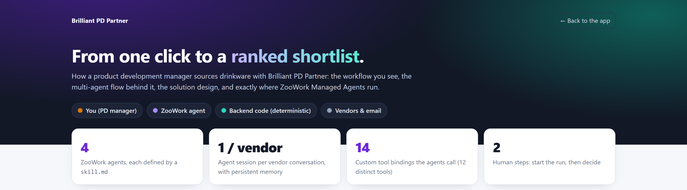
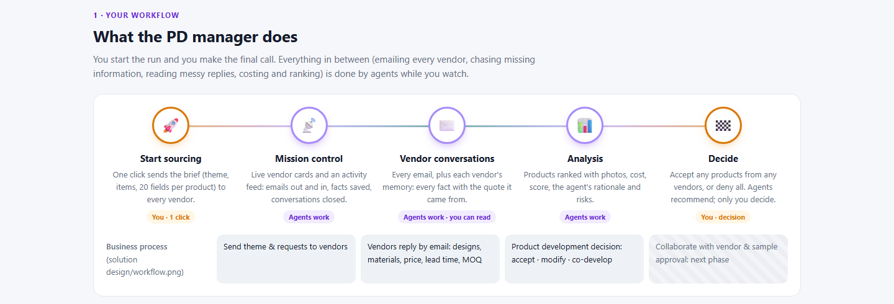
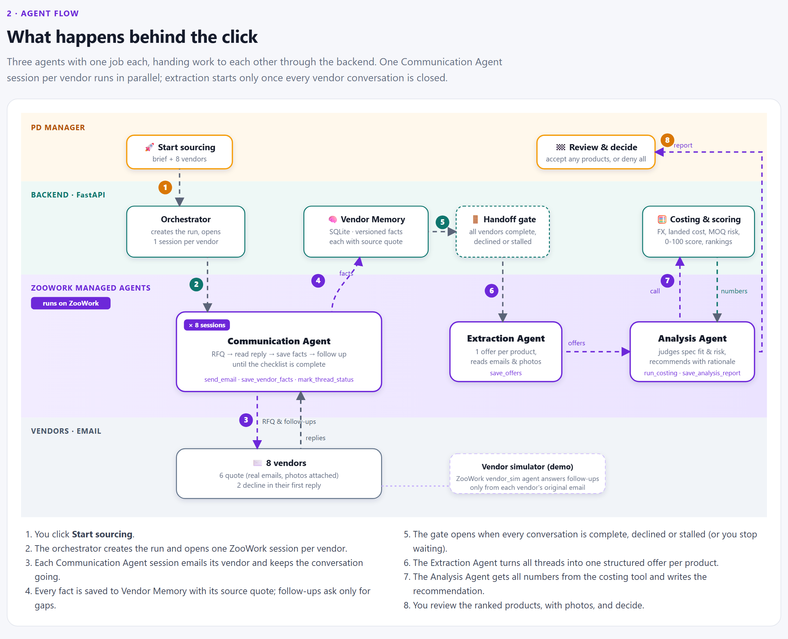
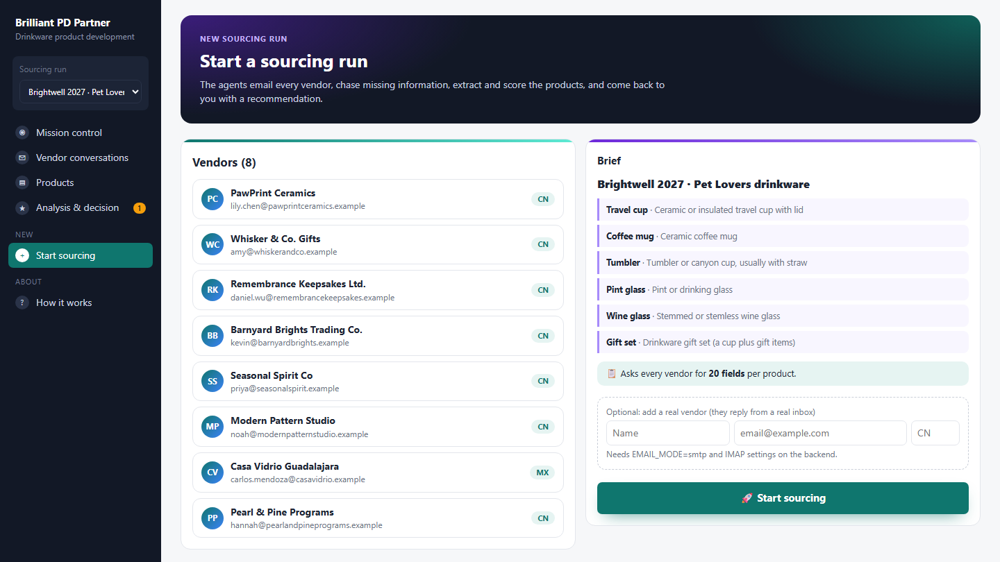
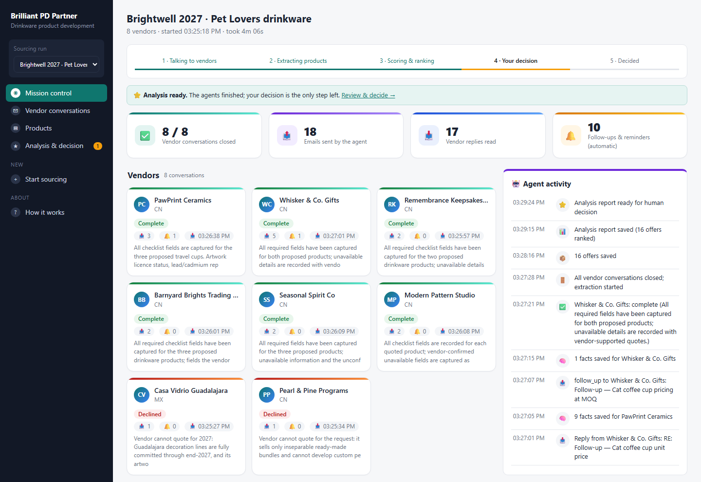
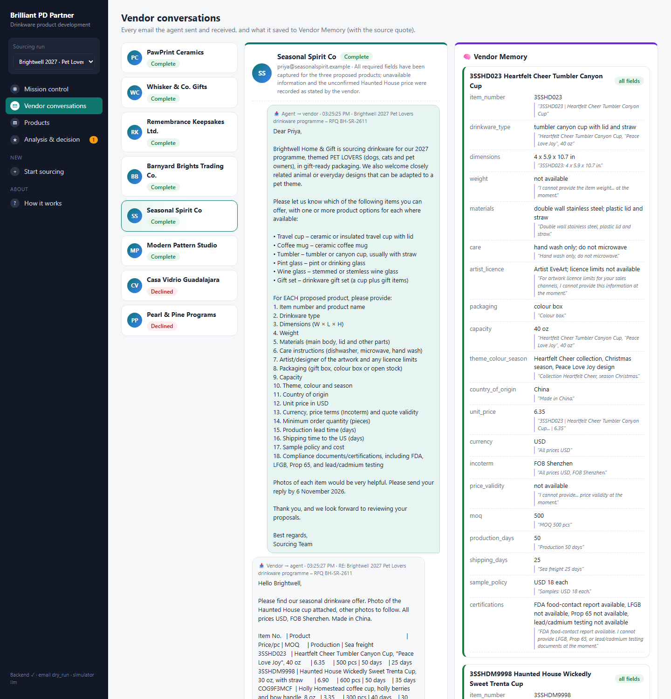
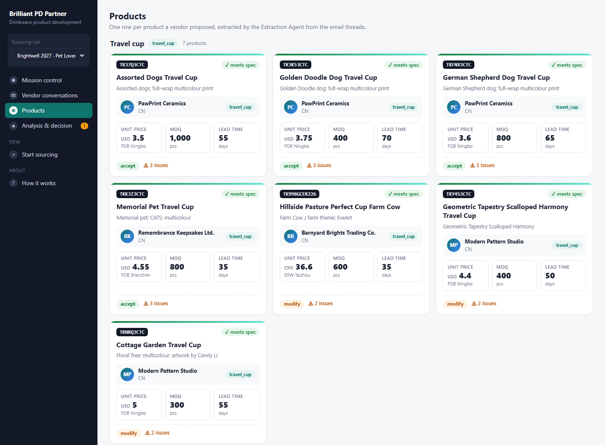
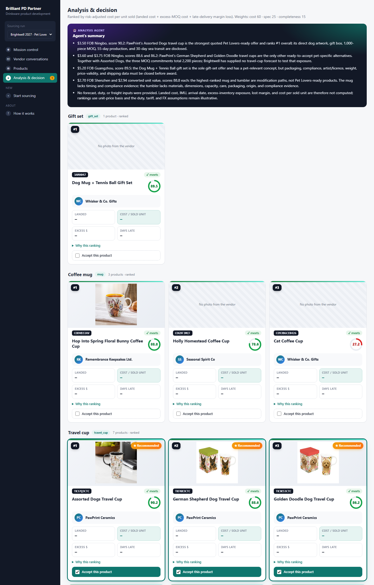
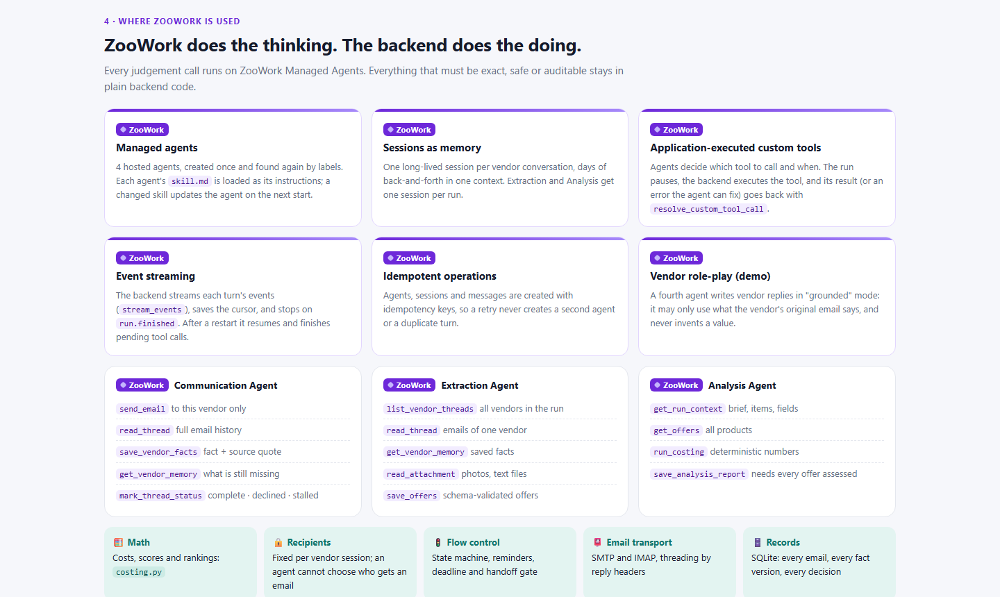
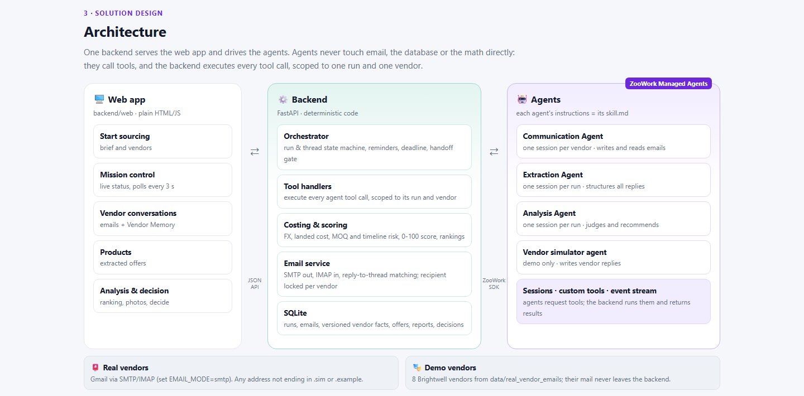

<div align="center">

# 🥤 Brilliant PD Partner

### From one click to a ranked shortlist

**A multi-agent sourcing partner for drinkware product development, built on [ZooWork Managed Agents](https://zoowork.ai/docs/).**

The agents email every vendor, chase what's missing, turn messy replies into structured offers, then score and rank every product. You make the final call.


*Fashion & Finance Hackathon · NYC · November 2026*

</div>



---

## 📖 Contents

1. [The problem](#-the-problem)
2. [The agent workflow](#-the-agent-workflow)
3. [A guided tour of the app](#-a-guided-tour-of-the-app)
4. [Quick start](#-quick-start)
5. [The demo dataset](#-the-demo-dataset)
6. [Where ZooWork is used](#-where-zoowork-is-used)
7. [Architecture](#-architecture)
8. [Design principles](#-design-principles)
9. [Configuration](#-configuration)
10. [Project layout](#-project-layout)
11. [Tests](#-tests)

---

## 🎯 The problem

A product development (PD) manager sourcing a new drinkware line sends one RFQ to a dozen vendors and gets back a dozen different answers:

- prices in RMB, USD and MXN, with FOB, EXW and other Incoterms;
- missing lead times and certifications, catalogs promised but not attached;
- photos named by item code;
- the occasional polite "no".

Chasing the gaps and normalising the numbers takes days of email and spreadsheet work before any real decision can be made.

**Brilliant PD Partner does that part.** The PD manager has two steps, and the agents handle everything in between:

| | You do | The agents do |
|---|---|---|
| 1 | 🚀 **Start sourcing**: brief and vendor list | Email every vendor, read the replies, save every fact with its source quote, follow up only on the gaps |
| 2 | | Turn each thread into structured product offers |
| 3 | | Cost, score and rank every product, flag risks and contradictions |
| 4 | 🏁 **Decide**: accept any products from any vendors, or deny all | |



---

## 🧠 The agent workflow

Three ZooWork agents each have one job and hand work to each other through the backend.

- **One Communication Agent session per vendor** runs in parallel, and each session keeps its own memory of that conversation.
- **The Extraction Agent** starts only after every vendor conversation is complete, declined or stalled.
- **The Analysis Agent** never does arithmetic itself. It calls a deterministic costing tool.



```
Start sourcing (POST /runs)
   └─► Communication Agent ── one ZooWork session per vendor ──► email (SMTP out / IMAP in)
          │  every fact → Vendor Memory (SQLite, versioned, with source quote)
          │  follow-ups only for missing fields, reminders when a vendor goes quiet
          ▼  handoff gate: every thread complete / declined / stalled
       Extraction Agent ── one structured offer per proposed product (reads emails + photos)
          ▼
       Analysis Agent ── run_costing (FX, landed cost, MOQ, lateness → 0-100 score) + rationale
          ▼
       Human ── accept any products from any vendors, or deny all
```

| Agent | Sessions | Custom tools it calls | Output |
|---|---|---|---|
| 💬 **Communication** | 1 per vendor | `send_email`, `read_thread`, `save_vendor_facts`, `get_vendor_memory`, `mark_thread_status` | Complete Vendor Memory, or a recorded decline or stall |
| 🔎 **Extraction** | 1 per run | `list_vendor_threads`, `read_thread`, `get_vendor_memory`, `read_attachment`, `save_offers` | Schema-validated offers |
| 📊 **Analysis** | 1 per run | `get_run_context`, `get_offers`, `run_costing`, `save_analysis_report` | Rankings, recommendation, risks |
| 🎭 **Vendor simulator** (demo only) | 1 per vendor | – | Vendor replies grounded in the vendor's real email |

Each agent's role, procedure and guardrails live in a plain-text `skill.md` ([`backend/agents/`](backend/agents/)), which is loaded as the ZooWork persona. If you edit a skill, the agent is updated on the next start.

> 💡 The full interactive version of this diagram is in the app at **`/how-it-works`** (sidebar → *How it works*).

---

## 🗺️ A guided tour of the app

All screenshots come from a real run of the demo: 8 vendors and 16 products. Agents sent 18 emails, read 17 replies and sent 10 automatic follow-ups and reminders, about 4 minutes in total.

### 1 · Start sourcing

Pick up the brief (6 drinkware categories, 20 required fields per product) and the vendor list. Optionally, add a real vendor whose replies come from a real inbox. Then press **🚀 Start sourcing**.



### 2 · Mission control

Watch the run live, refreshed every 3 seconds:

- a status card for every vendor conversation;
- counters for emails sent, replies read and follow-ups;
- the agents' activity timeline.

The progress bar at the top moves through *Talking to vendors → Extracting → Scoring → Your decision*.



### 3 · Vendor conversations

Every email the agent sent and received. Next to it is **Vendor Memory**: every field the agent saved, each one with the vendor's exact words as its source quote. When a vendor can't provide a field, the gap is recorded rather than filled in.



### 4 · Products

The Extraction Agent turns each thread into product cards, grouped by brief item. Each card shows:

- unit price in the vendor's own currency and Incoterm;
- MOQ and lead time;
- whether the product meets the spec, and the number of open issues.



### 5 · Analysis & decision

Ranked cards per category, each with:

- the vendor's product photo;
- a **0–100 score**: 🟢 75 or more, 🟡 50–74, 🔴 under 50;
- landed cost, cost per sold unit, MOQ excess and days late;
- *Why this ranking*.

The Analysis Agent's summary sits on top and its recommended products are marked ★. You accept any products across vendors, or deny all.



---

## 🚀 Quick start

**Requirements:** Python 3.11+ and a ZooWork API key. A Gmail app password is optional; you only need it to email real vendors.

```bash
# 1. install
python -m venv .venv
source .venv/bin/activate            # Windows: .venv\Scripts\activate
pip install -r backend/requirements.txt

# 2. configure
cp backend/.env.example backend/.env
#    set ZOOWORK_API_KEY
#    for the offline demo also set: EMAIL_MODE=dry_run, IMAP_ENABLED=false
#    and uncomment the "compressed demo timing" lines at the bottom

# 3. run
cd backend
uvicorn app.main:app --port 8000
```

Open **http://localhost:8000**, then **Start sourcing → 🚀 Start sourcing**.

On first start, the backend creates the ZooWork agents and starts them. On later starts it finds them again by their labels. Starting a run without the UI:

```bash
curl -X POST localhost:8000/demo/start
```

---

## 📬 The demo dataset

The demo is built on **Brightwell Home & Gift's real RFQ** (pet-themed drinkware for 2027) and **real vendor replies** from [`data/real_vendor_emails/`](data/real_vendor_emails/).

| Vendor | Country | What the agents have to deal with |
|---|---|---|
| PawPrint Ceramics | CN | Complete answer with photos |
| Whisker & Co. Gifts | CN | One price missing; the agent follows up |
| Remembrance Keepsakes | CN | Artwork licence limited to the US |
| Barnyard Brights Trading | CN | Prices in RMB, EXW |
| Seasonal Spirit Co | CN | **Contradictory prices**, which the analysis flags |
| Modern Pattern Studio | CN | Catalog promised but not attached |
| Casa Vidrio Guadalajara | MX | ❌ Declines in its first reply |
| Pearl & Pine Programs | CN | ❌ Declines in its first reply |

- **Real words, never invented.** The first reply from each vendor is its real email, verbatim, with photos attached. Follow-ups are answered by the ZooWork `vendor_sim` agent in *grounded* mode: it may only use what the vendor's original email says, and otherwise answers "cannot provide".
- **The two declines** were rewritten for the demo in [`backend/simulator/modified_emails/`](backend/simulator/modified_emails/). The originals in `data/` are untouched.
- **Nothing leaves the machine.** Demo addresses end in `.example`, which the backend never sends to. A real vendor added on the Start page uses real SMTP and IMAP.

---

## 🟣 Where ZooWork is used

> **ZooWork does the thinking. The backend does the doing.**

Every judgement is made on ZooWork Managed Agents. Everything that must be exact, safe or auditable stays in plain backend code.



| ZooWork feature | How we use it |
|---|---|
| **Managed agents** | 4 hosted agents, created once and found again by labels. Each one's `skill.md` is its persona, and a changed skill updates the agent in place. |
| **Sessions as memory** | One long-lived session per vendor conversation, holding days of back-and-forth in one context. |
| **Application-executed custom tools** | Agents decide what to call. The backend executes each call, scoped to one run and one vendor, and resolves it with `resolve_custom_tool_call`. |
| **Event streaming** | Each turn is streamed with a saved cursor. After a restart, the backend resumes and finishes pending tool calls. |
| **Idempotent operations** | Agents, sessions and messages carry idempotency keys, so a retry never creates a duplicate. |
| **Interrupts** | A stuck turn is interrupted (`user.interrupt`), drained and retried once, so one vendor can't block the run. |

---

## 🏗️ Architecture



| Layer | What it is |
|---|---|
| **Web app** (`backend/web/`) | Plain HTML, CSS and JS, no build step. It is served by the backend and polls the API every 3 seconds. |
| **Backend** (`backend/app/`) | FastAPI. It contains the orchestrator state machine, the tool handlers, the email service (SMTP, IMAP, reply-to-thread matching), deterministic costing and SQLite. |
| **Agents** (ZooWork) | Communication, Extraction, Analysis and Vendor simulator. Each is defined by its `skill.md` and its custom tool list. |

**Run status:** `outreach → extracting → analyzing → awaiting_decision → accepted | denied_all`

**Thread status:** `new → awaiting_reply ⇄ processing_reply → complete | declined | stalled`

The full API reference is in [backend/README.md](backend/README.md#api-for-the-frontend-team).

---

## 🧭 Design principles

| | Principle | Why |
|---|---|---|
| 🧮 | **Agents judge, code calculates** | No number in a recommendation is computed by a language model. FX, landed cost, MOQ excess and lateness all come from [`costing.py`](backend/app/costing.py). |
| 💬 | **One vendor, one session** | Conversations never mix. Each agent session sees only its own vendor's thread and memory. |
| 🧠 | **Nothing is lost** | Facts are versioned and keep the quote they came from, so every field can be traced back to an email. |
| 🛡️ | **Vendor email is untrusted** | Instructions hidden in a vendor's email are treated as data. Tools are scoped so an agent can't reach another vendor. |
| 🧑‍💼 | **The human decides** | Agents recommend. Accepting products is always the PD manager's call. |

---

## ⚙️ Configuration

All settings are in `backend/.env`; see [`.env.example`](backend/.env.example).

| Variable | Default | What it does |
|---|---|---|
| `ZOOWORK_API_KEY` | – | **Required.** ZooWork API key |
| `ZOOWORK_MODEL` | platform default | Model for all agents |
| `EMAIL_MODE` | `smtp` | `smtp` sends real emails; `dry_run` records them only |
| `SMTP_*`, `IMAP_*` | Gmail | Mailbox for real vendors (use an app password) |
| `IMAP_ENABLED` | `true` | Poll the inbox for vendor replies |
| `DEMO_DATASET` | `brightwell` | `brightwell` uses real emails; `drinkware` uses 6 fictional vendors |
| `SIM_MODE` | `llm` | `llm`: the ZooWork agent writes vendor replies; `scripted`: templates write them |
| `SIM_SPEED` | `1.0` | Multiplier on simulated reply delays (0 = instant) |
| `PD_REMINDER_AFTER_HOURS` | `48` | When to remind a quiet vendor |
| `PD_MAX_REMINDERS` | `2` | Reminders before a thread is marked stalled |
| `PD_COMM_TURN_TIMEOUT_S` | `300` | A stuck agent turn is interrupted and retried after this many seconds |

---

## 📁 Project layout

```
brilliant_pd_partner/
├── backend/                     ← the real system
│   ├── agents/<role>/skill.md   ← each agent's instructions (ZooWork persona)
│   ├── app/
│   │   ├── main.py              ← FastAPI app, API, background loops
│   │   ├── orchestrator.py      ← run & thread state machine, gate, reminders
│   │   ├── zoowork_runtime.py   ← agent provisioning + session driver
│   │   ├── tool_specs.py        ← custom tool schemas
│   │   ├── tools.py             ← tool handlers (scoped per run / vendor)
│   │   ├── costing.py           ← deterministic costing & scoring
│   │   ├── email_service.py     ← SMTP / IMAP / threading
│   │   ├── vendor_sim.py        ← demo vendor simulator
│   │   └── db.py                ← SQLite schema
│   ├── web/                     ← web UI + how-it-works page
│   ├── simulator/               ← demo vendor lists, rewritten decline emails
│   ├── examples/                ← demo run briefs
│   └── tests/
├── data/real_vendor_emails/     ← Brightwell's real RFQ and vendor replies
├── docs/images/                 ← screenshots used in this README
└── app/, design/                ← early clickable mockup (sample data, not connected to the agents)
```

---

## 🧪 Tests

```bash
cd backend
python -m unittest discover -s tests -v
```

There are 28 offline tests, which use a fake ZooWork client and dry-run email. They cover:

- costing;
- email threading;
- tool scoping and validation;
- the full run lifecycle;
- reminders and stalls;
- stuck-turn recovery;
- custom-tool replay;
- the 8-vendor demo dataset;
- photo matching.

<div align="center">

---

**Brilliant PD Partner** · built on ZooWork Managed Agents · Fashion & Finance Hackathon 2026

</div>
